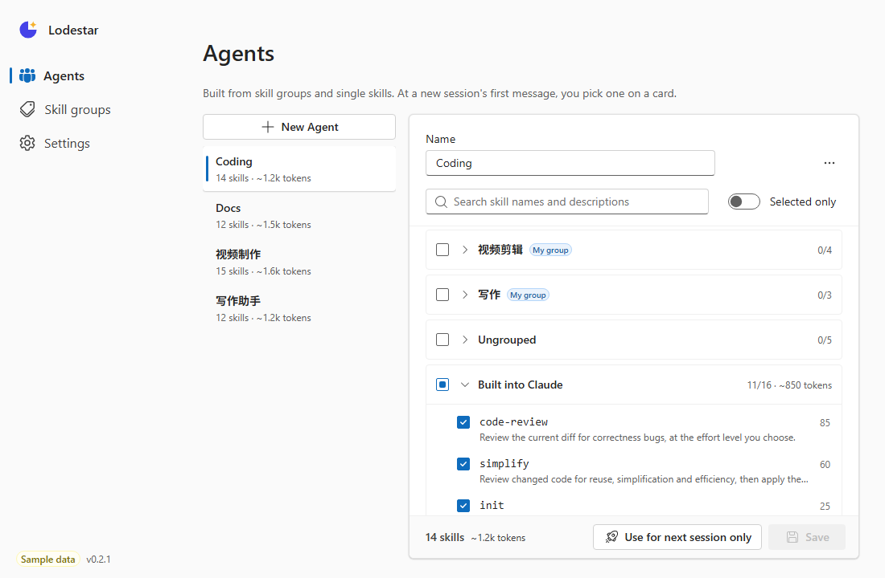

# Lodestar

English | [简体中文](README.zh-CN.md)

Choose which skills each Claude Code session loads, in the desktop app and the CLI. When you send the first message of a new session, you pick an **Agent**: a named set of skills. The model then sees only that set in its skill listing, and the subagents it starts get a set of their own. Skills outside the set take up no room in the listing, and the model won't call them on its own.

There are two parts:

- **The plugin** (`plugin/`) does the work inside Claude Code: the card at the first message, the filtered skill listing, and a panel for managing Agents.
- **The tray client** (`client/`, Windows, optional) is a desktop app for managing Agents and skill groups at any time, and for preparing a one-off set for the next session.

Both speak Chinese and English.

> Lodestar was called skill-loadout until v0.2.1. The plugin's ID (`skill-loadout`) and its data folder (`~/.skill-loadout`) keep that name, so existing installs and their data carry on as they are.



## Install

### The plugin

In the prompt box of a Claude Code session:

```
/plugin install skill-loadout --marketplace chipfighter/lodestar
```

Or in a terminal:

```
claude plugin install skill-loadout --marketplace chipfighter/lodestar
```

Press `y` to add the marketplace, then choose where to install. The plugin applies from the next new session. On its first run it creates `.skill-loadout/library.json` in your home folder, holding two example Agents (see [Defaults](#defaults-loadoutjson)).

### The tray client (Windows)

Download `Lodestar_<version>_x64-setup.exe` from the [latest release](https://github.com/chipfighter/lodestar/releases/latest) and run it. It installs for your user only and needs no administrator rights.

The installer isn't code-signed, so Windows SmartScreen may warn about an unknown publisher the first time: choose **More info**, then **Run anyway**.

Developed and tested in the Claude desktop app on Windows 11, with Claude Code 2.1.330.

## Two concepts

- **Skill group**: a category of skills.
  - Skills that come with a plugin or with Claude are grouped when they're installed: one group per plugin, and one for Claude's own skills. These groups can't be changed.
  - Skills you install one at a time (each a folder in `~/.claude/skills`) can go into groups you make, such as "AIGC" or "Video editing". A skill can be in only one group; the ones in no group are listed as Ungrouped.
- **Agent**: a set built from skill groups and single skills, for example "Video production" = AIGC + Voice-over + Video editing. Each session uses one Agent.

## How to use

- **Type and send the first message of a new session as usual.** Before Claude reads it, a card appears, the same kind Claude uses to ask you questions: "Which skill set for this session?"
  - The options are your Agents and **No limit** (every skill). The Agent you last used in this folder comes first, and each option lists the skill groups it contains and its total number of skills.
  - With more than three Agents, the card shows two at a time; choose **More Agents…** for the next two. You can also type an Agent's name in the card's Other box (case doesn't matter).
  - Your message reaches Claude only after you choose. The model hasn't read anything yet, so the prompt cache is unaffected, and your message arrives as you wrote it, attachments included.
  - If you close the card without choosing, the session starts with the current set (No limit unless you changed it).
- You can also choose before sending the first message, in the panel or by sending `/loadout Coding`; once you've chosen, the card doesn't appear. Sending `/loadout` alone opens the panel without setting Claude to work.
- **The set locks once the first message is sent** and stays until the session ends, because changing the skill listing midway would invalidate the cached conversation and the model would have to read all of it again.
  - Once the set is locked, the panel only shows which skills are loaded (open a group to see each skill).
  - To use a skill outside the set, write its name in your message. This doesn't affect the cache.
  - For a different set, start a new session. `/clear` also brings the card back.
  - A resumed session keeps the set it locked originally, without a card; sessions from before the plugin was installed count as No limit.
  - A session forked from another keeps the original's set, without a card. This includes the session the desktop app splits off on its own after you stop Claude partway.
- **Subagents.** When the main agent starts a subagent, the setting **Who picks** on the plugin's manage page, or "Who picks a subagent's skills" in the client, decides who chooses the subagent's set:
  - **Main agent** (the default): the main agent adds a line such as `skill loadout: Coding` (`lodestar: Coding` and `技能装配：Coding` work too) to the subagent's task, and the subagent loads only that set; without the line it gets the main session's set. The session's first skill listing tells Claude about this line and which Agents exist.
  - You can also name the set in your message, for example "start a subagent with the Coding skills…". If the main agent didn't add the line, the plugin gives the subagent the set your message names, as long as it names exactly one.
  - When the subagent starts, the main agent is told which set it got.
  - **Me**: a card asks you each time a subagent starts. The main agent's suggestion comes first, and the last option keeps the set of the main session (or of the parent agent).
  - A forked subagent always keeps its parent's set, without asking.
  - A subagent's set is fixed when it starts and never changes. It can use only the skills in its set, plus any its task names. Once the session is locked, the panel shows each subagent's set and who chose it.
- **The plugin's panel.** After you close it, there are three ways to open it again: press **Open panel** on the Lodestar bar above the prompt box, type `/loadout`, or ask Claude to open the Lodestar panel. The bar shows only while the panel is closed. Its **Manage** page creates, edits and deletes Agents and skill groups (for individually installed skills only), and holds the settings. It works after the lock too; changes apply from the next new session.

## The tray client

The client stays in the system tray. Click its icon to open the window; closing the window puts it back in the tray, and **Quit** in the tray icon's menu exits. Starting it again brings the open window forward instead of starting a second copy.

- **Agents**: pick an Agent on the left; on the right, tick whole skill groups or open a group and tick single skills, with search. The bar at the bottom shows how many skills the set loads and roughly how many tokens their listing takes.
- **Skill groups**: make, rename and delete your own groups, and tick which individually installed skills each holds. Groups from plugins and from Claude can only be viewed. Every skill shows its description and which Agents use it.
- **Settings**: the plugin's two card settings, the language, starting with Windows, the data folder, and restoring the defaults.

Changes are saved to the same `library.json` the plugin reads, and the window follows changes made in the plugin's panel (or by hand) as they happen.

### A one-off set for the next session

In the Agent editor, tick the skills you want for the next session, then press **Use for next session only** instead of **Save**. The Agent itself doesn't change.

When you send the first message of a new session, the card's first option is **Prepared in the client**, with a note on the Agent it started from and the skills added or dropped. Pick it as you would an Agent. A prepared set lasts two hours and goes to one session only; the client shows when a session has taken it.

If the card is already open when you prepare the set, type `client` (or `客户端`) in the card's Other box. You can also send `/loadout client` before the first message.

## Language

The plugin's card, panel and bar, and the client, are in Chinese or English. Choose in the client's Settings, or set `language` in `library.json`:

- `"zh"` or `"en"`: always that language.
- `"auto"` (the default): the plugin goes by Claude Code's own `language` setting when it names Chinese or English; otherwise by the language of a session's first message, and before that, by the language the previous session ended up with (English if nothing is known yet). The client follows the Windows display language.

Messages that only the model reads, such as a note on a refused skill call, are always in English.

## The data files, for other tools

Agents, skill groups and settings are kept in plain JSON files, which the client and future adapters for other agent platforms read and write too.

- Location: a `.skill-loadout` folder in your home folder (`C:\Users\<you>\.skill-loadout` on Windows), or the folder named by the `SKILL_LOADOUT_HOME` environment variable when it's set. The plugin's manage page and the client's Settings show the path in use.
- `library.json`: Agents, skill groups and settings.
  - Changes made in the panel or the client are written to this file. You can also edit it by hand; the plugin reads it the next time you open the panel, go to the manage page or start a new session, and the client as soon as it changes.
  - On first run, it's created from settings the plugin stored earlier, if any; otherwise from the defaults in `loadout.json`.
  - If the file has a format error, the plugin and the client leave it alone, keep using the settings they read last and say so. A change made in either then overwrites the file.
  - Fields the plugin and client don't know are kept when they save, so another tool can keep its own settings here.
- `claude-code-skills.json`: the skills Claude Code actually sees (from any session in the last two weeks), with their descriptions, and the always-on skills. The plugin writes it for other tools to display and never reads it, so editing it has no effect.
- `next-session.json`: the set prepared for the next session. The client writes it; the plugin offers it on the card and marks it taken (`usedBy`).
- `client.json`: written by the client each time it starts. While it names a client program that's still installed, the card mentions how to pick a set prepared there.

The format of `library.json`:

```json
{
  "version": 1,
  "askOnNewSession": true,
  "subagentPicker": "agent",
  "language": "auto",
  "groups": {
    "Video editing": ["hyperframes", "remotion-*", "!remotion-license"]
  },
  "agents": {
    "Video production": { "groups": ["g:Video editing", "p:figma"], "skills": ["media-use"] }
  }
}
```

- `askOnNewSession`: whether a card appears at a new session's first message.
- `subagentPicker`: who picks a subagent's skills, `"agent"` (the main agent) or `"person"` (you, on a card).
- `language`: `"auto"`, `"zh"` or `"en"`; see [Language](#language).
- `groups`: groups of individually installed skills, mapping a group name to a list of skill names. `*` is a wildcard (as in `remotion-*`), and `!name` leaves a skill out.
- `agents`: maps an Agent name to `{ "groups": [...], "skills": [...] }`. Each entry in `groups` is a group ID: `g:<group>` for one of your groups, `p:<plugin>` for a whole plugin, or `s:built-in` for Claude's own skills; a bare group name means `g:<group>`. `skills` lists single skills, and wildcards work there too.

`next-session.json` has the same `groups` and `skills`, plus the Agent it started from and when it was prepared:

```json
{
  "version": 1,
  "basedOn": "Coding",
  "groups": [],
  "skills": ["code-review", "simplify", "sql-helper"],
  "createdAt": "2026-11-23T10:00:00.000Z",
  "usedBy": null
}
```

## Defaults: loadout.json

The defaults that ship with the plugin, in `plugin/loadout.json`. They're used only when `library.json` is first created and when you restore the defaults.

- Two example Agents, using only skills that come with Claude Code and the Claude desktop app:
  - `Coding`: code-review, simplify, init, run, claude-api, fewer-permission-prompts and security-review.
  - `Docs`: the Word, PDF, Excel, PowerPoint and docs skills (`anthropic-skills:docx` and the rest, which come with the Claude desktop app).
  - No skill groups: put your individually installed skills into groups yourself.
- `groups` and `presets`: the default skill groups and Agents, in the same format as above (`presets` is `agents`).
- `alwaysOn`: skills kept in every set, which sessions rely on, such as the desktop app's skills for drawing Artifacts and using browsers. This list is set only here.

## How it works

- **Choosing**: before the first message enters the session (`prompt.submit` hook), the plugin asks you on the card Claude itself uses for questions (`$.ui.ask`), and holds the message until you choose. Time spent waiting doesn't count against the plugin's time limit. Each time the card shows, it reads the data files again, so an Agent or a set prepared in the client meanwhile appears on the next card.
- **Filtering**: the plugin rewrites the `skill_listing` message sent to the model (`prompt.attachment` hook). It changes no settings files, so sessions running at the same time can use different sets, and single skills inside a plugin can be kept or left out one by one.
- **Locking**: when the session's first turn starts (`turn.start` hook), the set is frozen and stored under the session's ID, to be picked up again when the session is resumed.
- **Forks**: as each of Claude's replies is saved to the conversation (`session.append` hook), the plugin records the reply's fingerprint (a hash of its text with the whitespace removed; the text itself isn't stored) with the session's lock. A forked session has no lock of its own, so the plugin fingerprints the replies copied into it, finds the session that shares the most of them, and keeps that session's set. Replies work better than prompts here: many sessions open with the same "hi", but two replies are almost never word for word the same.
- **Subagents**: a subagent's set is fixed when it starts (`agent.spawn` hook) and remembered by the subagent's ID. Its skill listing (a `skill_listing` carrying that ID) is filtered to the set, and its task gets a line saying which skills it can use.
- **Backstop**: if the model calls a skill outside the set anyway, the call is refused (`tool.call` hook), for the main session and each subagent by its own set. Skills that you name in a message, or that a subagent's task names, are still allowed.
- **The client** is a [Tauri](https://tauri.app) app (Rust, with a React and Fluent UI page in WebView2). It shares the plugin's own code for groups, wildcards and Agents (`plugin/hooks/listing.ts`), writes each file whole (to a temporary file, then swapped in) so that the plugin never reads half of one, and watches the data folder for changes.

## Known limits

- The client is for Windows only for now. Its code isn't tied to Windows, but no macOS or Linux build has been made or tested.
- The installer isn't code-signed; see [the tray client](#the-tray-client-windows).
- With `language` set to `auto`, the plugin and the client can differ: the plugin follows your messages, the client follows Windows. Set the language explicitly to keep them the same.
- Forks are matched by the fingerprints of Claude's replies. Very short replies (under 20 characters) and error messages don't count, because another session may contain the same ones word for word. Once the original's replies have all been compacted away, a fork can't be matched and gets No limit.
- In a new session started by another session's tool, a first message reading `/loadout <name>` reaches Claude as an ordinary message instead of running the command. Whether sending `/loadout` yourself in the prompt box has the same problem hasn't been tested.
- Whether the main agent adds that line as instructed depends on the model; Haiku never has. That's why a set you name in your message counts too, and why the main agent is told which set a subagent got once it starts.
- New sessions started by another session or by a scheduled task also show the card at their first message, and wait until someone chooses. If you don't want that, turn the card off.
- Subagents' sets are remembered only by the running process: after a restart, an earlier subagent that is woken up again gets the main session's set.
- If two places change Agents or skill groups at the same moment, the later save wins. The client reads the file again right before each save, so this needs two saves within a fraction of a second.

## Development

- Layout: `plugin/` is the Claude Code plugin, `client/` the tray client, and the repository root holds the marketplace manifest (`.claude-plugin/marketplace.json`).
- The plugin:
  - To install from a local folder: `claude plugin marketplace add <this folder>`, then `claude plugin install skill-loadout@skill-loadout`. After changing the code, type `/reload-plugins` in a session or start a new one.
  - Checks: `claude plugin validate plugin` and `claude plugin test plugin`. Type checking (`tsc -p plugin`) uses the definitions in `plugin/.claude-plugin/types/`, which Claude Code writes when it loads the plugin; they aren't kept in git.
- The client (needs Node.js with pnpm, and Rust with the Visual Studio C++ build tools):
  - `pnpm install` in `client/`, then `pnpm dev` to preview the page in a browser with sample data, or `pnpm tauri dev` to run the app.
  - Checks: `pnpm typecheck` and `pnpm test`.
  - `pnpm tauri build` makes the installer, in `client/src-tauri/target/release/bundle/nsis/`.

## License

MIT; see [LICENSE](LICENSE).
