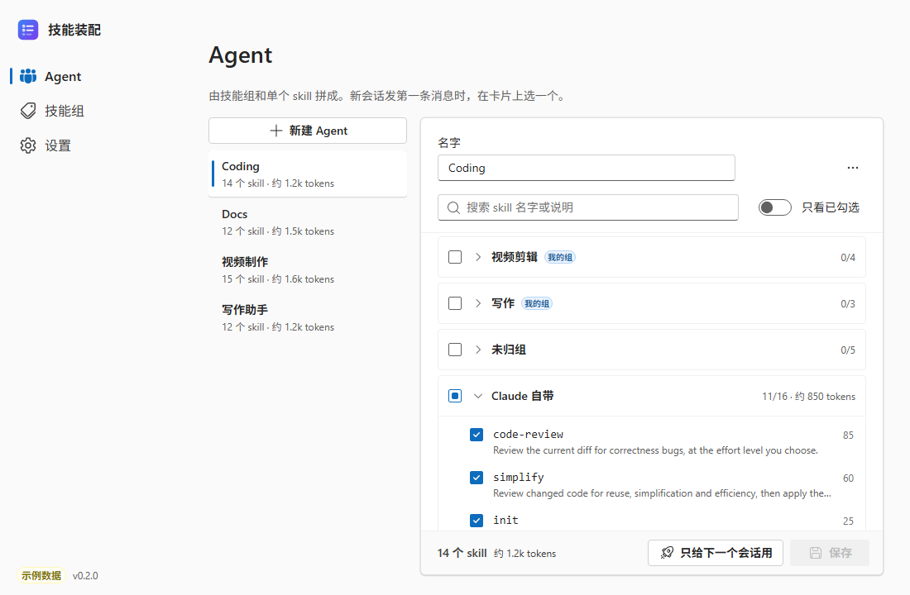

# skill-loadout（技能装配）

[English](README.md) | 简体中文

给 Claude Code（桌面端和命令行）选每个会话装配哪些 skill。新会话发第一条消息时，先选一个 **Agent**（一套起了名字的 skill）；模型只会在 skill 清单里看到这一套，它开的子代理也各有自己的一套。没装配的 skill 不占清单预算，模型也不会自己去调用。

分两部分：

- **插件**（`plugin/`）：在 Claude Code 里干活。第一条消息时弹的卡片、过滤后的 skill 清单，还有管理 Agent 的面板。
- **托盘客户端**（`client/`，Windows，可选）：随时管理 Agent 和技能组的桌面程序，还能给下一个会话临时调一套。

两部分都支持中文和英文。



## 安装

### 插件

在会话的输入框里：

```
/plugin install skill-loadout --marketplace chipfighter/skill-loadout
```

或者在终端里：

```
claude plugin install skill-loadout --marketplace chipfighter/skill-loadout
```

接着按 `y` 添加这个插件市场，再选安装范围。装好后新开一个会话就生效；第一次运行时，会在用户目录下生成 `.skill-loadout/library.json`，里面是两个示例 Agent（见下面「默认值」）。

### 托盘客户端（Windows）

从[最新的发布页](https://github.com/chipfighter/skill-loadout/releases/latest)下载 `Skill.Loadout_<版本>_x64-setup.exe`，运行它。只装给当前用户，不用管理员权限。

安装包没有代码签名，第一次运行时 Windows SmartScreen 可能提示「未知发布者」：点「更多信息」，再点「仍要运行」。

在 Windows 11 的 Claude 桌面端、Claude Code 2.1.330 上开发和测试。

## 两个概念

- **技能组**：skill 的分类。
  - 跟着插件或 Claude 一起装的 skill，装的时候就是一组（一个插件一组、Claude 自带一组），不能调整。
  - 零碎装的 skill（`~/.claude/skills` 里一个个的文件夹）可以自己归组，比如「AIGC制作」「剪辑视频」。一个零碎 skill 只能在一个组里；没归组的放在「未归组」。
- **Agent**：由几个技能组加上单个 skill 拼成，比如「视频制作」= AIGC制作 + 自媒体口播 + 剪辑视频。每个会话选一个。

## 怎么用

- **新会话照常打字、发送第一条消息。** Claude 读到消息之前，会弹出一张卡片（Claude 平时问你问题用的那种）：「这个会话用哪套技能？」
  - 选项是你的 Agent 和「不限制」（= 装全部 skill）。这个文件夹上次用的 Agent 排在第一个；每个选项下面写着它包含哪些技能组、一共多少个 skill。
  - Agent 超过 3 个时，两个一批，点「更多 Agent…」换下一批；也可以在卡片的「Other」里直接输入 Agent 名字（不分大小写）。
  - 选好之后消息才交给 Claude。这时模型还没读过任何东西，所以不影响缓存；消息原样保留，附件也不会丢。
  - 关掉卡片不选：这个会话按当前的装配开始（没动过就是「不限制」）。
- 发第一条消息前也可以先在面板里选，或者发 `/loadout Coding`；选过就不再弹卡片。只发 `/loadout` 会打开面板，不会让 Claude 开始干活。
- **发出第一条消息后，装配就锁定**，直到会话结束都不再变：中途改 skill 清单会让前面的对话缓存失效，模型要从头重新读一遍整段对话。
  - 锁定后面板只显示装了哪些 skill（点组名可以看每一个）。
  - 临时要用没装配的 skill：在消息里写出它的名字就能用，不影响缓存。
  - 想换一组 skill：新开一个会话。`/clear` 之后也会重新问。
  - 恢复以前的会话时，沿用它当初锁定的装配，不弹卡片；装这个插件之前的会话，按「不限制」处理。
  - 从现有会话 fork 出来的新会话，沿用原会话的装配，不弹卡片。中途停下后桌面端自动分出来的会话也算 fork。
- **子代理**：主代理开子代理时，子代理用哪套技能，由插件管理页的「由谁来选」（客户端里是「子代理由谁来选」）决定：
  - 「主代理」（默认）：主代理在子代理的任务里写一行 `技能装配：Coding`（或 `skill loadout: Coding`），这个子代理就只装这一套；不写就和主会话一样。会话的第一份 skill 清单里会告诉 Claude 这个写法，以及有哪些 Agent 可选。
  - 你在消息里直接点名也行，比如"开一个子代理，用 Coding 那套技能……"：主代理没写那一行的话，插件按你消息里点名的那一套给子代理装配（消息里只点名一套时才算）。
  - 子代理开出来后，主代理会收到一句说明，知道这个子代理装的是哪一套。
  - 「我来选」：每开一个子代理都弹卡片问你，主代理建议的排第一，最后一项是「和主会话一样」（子代理的子代理是「和上级代理一样」）。
  - fork 出来的子代理总是沿用上级的装配，不问。
  - 子代理的装配在它开出来时定下，之后不变；它只能用装配给它的 skill（任务里点了名的照常放行）。会话锁定后，面板里能看到每个子代理用的哪一套、是谁选的。
- **插件的面板**：关掉之后有三种方法打开：点输入框上方「技能装配」状态条里的「打开面板」；输入 `/loadout`；或者直接跟 Claude 说"打开技能装配面板"。状态条只在面板关着的时候出现。面板的「管理」页可以新建、编辑、删除 Agent 和技能组（技能组只能放零碎 skill），设置也在这里。锁定后也能用，修改从下一个新会话起生效。

## 托盘客户端

客户端常驻在系统托盘。点托盘图标打开窗口；关掉窗口只是缩回托盘，托盘图标右键菜单里的「退出」才会关掉它。再启动一次，会把已经开着的窗口调到前面，不会开出第二个。

- **Agent**：左边选一个 Agent，右边勾整个技能组，或者展开组勾单个 skill，可以搜索。底部显示这一套装多少个 skill、清单大约占多少 tokens。
- **技能组**：新建、改名、删除自己的组，勾选每个组放哪些零碎 skill。插件带来的组和 Claude 自带的组只能看。每个 skill 都显示它是干什么的、哪些 Agent 用了它。
- **设置**：插件卡片的两项设置、语言、开机启动、数据文件夹、恢复默认设置。

改动保存在插件也读的同一个 `library.json` 里；在插件面板里改了（或者直接改了文件），窗口里马上跟着变。

### 给下一个会话临时调一套

在 Agent 编辑页勾好下一个会话要用的 skill，点「只给下一个会话用」（而不是「保存」）。Agent 本身不变。

新开会话发第一条消息时，卡片的第一项就是「客户端里调好的」，下面写着它基于哪个 Agent、加了几个、减了几个。像选 Agent 一样点它就行。调好的这套 2 小时内有效，只给一个会话用；被会话用掉后，客户端里会显示出来。

如果卡片已经弹出来了才去客户端调，调好后在卡片的「Other」里输入「客户端」（或 `client`）。发第一条消息前发 `/loadout 客户端` 也行。

## 语言

插件的卡片、面板、状态条和客户端都有中文和英文两种。在客户端的「设置」里选，或者在 `library.json` 里设 `language`：

- `"zh"` 或 `"en"`：固定用这种语言。
- `"auto"`（默认）：插件先看 Claude Code 自己的 `language` 设置，是中文或英文就用它；没有的话看会话第一条消息用的语言；第一条消息之前，沿用上一个会话最后用的语言（什么都不知道时用英文）。客户端跟随 Windows 的显示语言。

只给模型看的话（比如拒绝调用某个 skill 时的说明）一律用英文。

## 数据文件：给别的工具用

Agent、技能组和设置存在普通的 JSON 文件里，客户端和以后别的 agent 平台的适配都读写它们。

- 位置：用户目录下的 `.skill-loadout` 文件夹（Windows 上是 `C:\Users\<用户名>\.skill-loadout`）；设了环境变量 `SKILL_LOADOUT_HOME`，就用那个文件夹。插件的管理页和客户端的「设置」里都显示实际路径。
- `library.json`：Agent、技能组和设置。
  - 面板和客户端里的修改都写进这个文件；也可以直接编辑它。插件在下次打开面板、进管理页或者开新会话时读取，客户端在文件一变就读取。
  - 第一次运行时，用插件以前存的设置生成；没有的话用 `loadout.json` 的默认值。
  - 文件格式写错了：插件和客户端都不会动它，先用上次读到的设置，并提示出来；这时在任何一边改动，都会覆盖这个文件。
  - 插件和客户端保存时，会原样保留它们不认识的字段，别的工具可以把自己的设置也放在这里。
- `claude-code-skills.json`：Claude Code 实际看到的 skill（最近两周任何会话见过的）和它们的说明，以及常驻的 skill。插件写给别的工具显示用，自己不读它，改它没有效果。
- `next-session.json`：给下一个会话调好的那一套。客户端写；插件在卡片上提供它，用掉后在文件里记下（`usedBy`）。
- `client.json`：客户端每次启动时写。它记的客户端程序还在的话，卡片上会提示怎么选客户端里调好的那一套。

`library.json` 的格式：

```json
{
  "version": 1,
  "askOnNewSession": true,
  "subagentPicker": "agent",
  "language": "auto",
  "groups": {
    "剪辑视频": ["hyperframes", "remotion-*", "!remotion-license"]
  },
  "agents": {
    "视频制作": { "groups": ["g:剪辑视频", "p:figma"], "skills": ["media-use"] }
  }
}
```

- `askOnNewSession`：新会话发第一条消息时是否弹卡片。
- `subagentPicker`：子代理的技能由谁选，`"agent"`（主代理）或 `"person"`（弹卡片问你）。
- `language`：`"auto"`、`"zh"` 或 `"en"`，见上面「语言」。
- `groups`：零碎 skill 的技能组，组名 → skill 名列表，支持 `*` 通配（如 `remotion-*`），`!名字` 表示排除。
- `agents`：Agent 名 → `{ "groups": [...], "skills": [...] }`。`groups` 里写组的编号：`g:组名`（自己的技能组）、`p:插件名`（整个插件）、`s:built-in`（Claude 自带）；只写组名也算 `g:组名`。`skills` 写单个 skill，也可以用通配。

`next-session.json` 的 `groups`、`skills` 和 Agent 一样，另外记着基于哪个 Agent、什么时候调的：

```json
{
  "version": 1,
  "basedOn": "Coding",
  "groups": [],
  "skills": ["code-review", "simplify", "sql-helper"],
  "createdAt": "2026-11-23T10:00:00.000Z",
  "usedBy": null
}
```

## 默认值：loadout.json

插件自带的默认值，在 `plugin/loadout.json`，只在两种时候用到：第一次生成 `library.json`，和「恢复默认设置」。
- 两个示例 Agent，只用 Claude Code 和 Claude 桌面端自带的 skill：
  - `Coding`：code-review、simplify、init、run、claude-api、fewer-permission-prompts、security-review；
  - `Docs`：Word、PDF、Excel、PPT 和文档几个 skill（`anthropic-skills:docx` 等，Claude 桌面端自带）。
  - 没有技能组：零碎装的 skill 自己归组。
- `groups`、`presets`：默认的技能组和 Agent，格式同上（`presets` 就是 `agents`）。
- `alwaysOn`：任何装配下都保留的 skill（会话依赖的系统类 skill，比如桌面端画 Artifact、用浏览器的那几个）。这一项只在这里设置。

## 原理
- 选择：第一条消息进入会话之前（`prompt.submit` 钩子），用 Claude 自己提问的卡片问你（`$.ui.ask`），消息等你选完再放行。等待的时间不算插件超时。卡片每弹一次都重新读一遍数据文件，所以这期间在客户端里新建的 Agent 或调好的一套，下一张卡片上就有。
- 过滤：改写发给模型的 `skill_listing` 消息（`prompt.attachment` 钩子）。不改任何设置文件，所以几个会话可以同时用不同的装配，插件里的单个 skill 也能单独取舍。
- 锁定：会话第一轮开始时（`turn.start` 钩子）冻结装配，并按会话编号存起来，恢复会话时取回。
- fork：Claude 的每条回复存进对话时（`session.append` 钩子），插件把它的指纹（去掉空白后的哈希，不存原文）记在会话的锁定记录下。fork 出来的会话没有自己的记录，就算出复制过来的各条回复的指纹，找到共同回复最多的那个会话，沿用它的装配。用回复而不用提问，是因为很多会话的第一句都是「你好」，回复却几乎不会一字不差。
- 子代理：子代理开出来时（`agent.spawn` 钩子）定下它的装配，按子代理编号记住；它的 skill 清单（带子代理编号的 `skill_listing`）照这套过滤，任务里也附上一行它能用哪些 skill。
- 兜底：模型如果自己调用了没装配的 skill，会被拒绝（`tool.call` 钩子，主会话和每个子代理各按各的装配）；用户在消息里点名的、或者子代理任务里点名的 skill 照常放行。
- 客户端：用 [Tauri](https://tauri.app) 做的（Rust，加上 WebView2 里的 React 和 Fluent UI 页面）。分组、通配、展开 Agent 用的是插件自己的那份代码（`plugin/hooks/listing.ts`）；写文件时先写临时文件再整个换上去，插件不会读到写了一半的文件；数据文件夹有变化时马上知道。

## 已知限制
- 客户端暂时只有 Windows 版。代码本身不依赖 Windows，但还没出过 macOS、Linux 版，也没测过。
- 安装包没有代码签名，见上面「托盘客户端（Windows）」。
- `language` 是 `auto` 时，插件和客户端可能不一样：插件跟着你的消息，客户端跟着 Windows。想一致就固定一种语言。
- fork 靠 Claude 回复的指纹认原会话；太短的回复（不到 20 个字）和报错信息不算，因为别的会话可能一字不差。原会话的回复都被压缩掉以后就认不出来，按「不限制」处理。
- 别的会话用工具开出来的新会话，第一条消息就算写的是 `/loadout 名字`，也会当成普通消息发给 Claude，不会执行这个命令。你自己在输入框里发 `/loadout` 有没有这个问题，还没试过。
- 主代理能不能照说明写那一行，看模型本身；Haiku 就没照做过。所以你在消息里点名的那一套也算数，主代理开子代理之后也会收到一句它装的是哪一套。
- 别的会话或定时任务开出来的新会话，第一条消息也会弹卡片，要有人选了才继续。不需要的话把卡片关掉。
- 子代理的装配只记在当前进程里：重启后再唤醒以前的子代理，它沿用主会话的装配。
- 两个地方同时改 Agent 或技能组，以后保存的为准。客户端每次保存前都会重新读一遍文件，所以要在不到一秒内两边都保存才会碰上。

## 开发
- 目录：`plugin/` 是 Claude Code 插件，`client/` 是托盘客户端；仓库根目录放的是插件市场的清单（`.claude-plugin/marketplace.json`）。
- 插件：
  - 从本地文件夹装：`claude plugin marketplace add <这个文件夹>`，再 `claude plugin install skill-loadout@skill-loadout`。改了代码以后，在会话里输入 `/reload-plugins`，或者新开一个会话。
  - 检查：`claude plugin validate plugin`、`claude plugin test plugin`。类型检查（`tsc -p plugin`）用 `plugin/.claude-plugin/types/` 里的定义：Claude Code 加载插件时自动生成，不进 git。
- 客户端（需要装了 pnpm 的 Node.js，以及 Rust 和 Visual Studio 的 C++ 生成工具）：
  - 在 `client/` 里运行 `pnpm install`，然后 `pnpm dev` 在浏览器里用示例数据预览页面，或者 `pnpm tauri dev` 运行整个程序。
  - 检查：`pnpm typecheck`、`pnpm test`。
  - `pnpm tauri build` 打出安装包，在 `client/src-tauri/target/release/bundle/nsis/`。

## 许可证
MIT，见 [LICENSE](LICENSE)。
